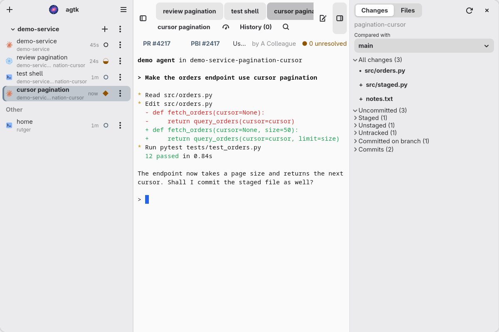

# agtk

My native GNOME workspace for running many coding agents at once.

agtk is personal software. I built it for myself, together with the coding agents it runs, and it fits how I work: Arch Linux, GNOME on Wayland, Claude Code and Codex, Azure DevOps pull requests, and Emacs. It is not a product or a community project. There is no issue tracker and no roadmap, and I don't take pull requests.

If you want to use it, fork it and make it yours. agtk is built to be changed by its own agents: when it starts with nothing open, it opens Claude Code in its own source code and asks what you want to know or change. See [Make it yours](#make-it-yours).

agtk runs Claude Code, Codex, Gemini and plain shells side by side in one window, grouped by project and git worktree. It shows which agent needs you, what each one changed, and keeps every session running even when the window closes.



## Highlights

- **Know which agent needs you.** Every session shows a live state: busy, waiting for input, ready for review, or idle. `Ctrl+Shift+Space` jumps to the next session that is ready.
- **Usage at a glance.** The bottom bar shows account quota on the left, selected-session tokens and a ring showing how full its context window is in the middle, and whole-machine CPU/RAM on the right. Click a section for details and quota reset times. Claude and Codex token usage comes from local logs. Codex logs report the context window size; Claude Code reports it to a silent status line that agtk adds, unless you have a status line of your own.
- **Sessions outlive the window.** Each terminal runs in its own process. Close, crash, or rebuild agtk and it reattaches to every running agent. After a reboot it offers to resume each conversation where it stopped.
- **Worktree-native.** Launch an agent in a fresh worktree with a generated branch in one step. Removing a worktree saves uncommitted work and tags the branch tip first, so nothing is lost.
- **Review without leaving the window.** The Changes sidebar shows staged, unstaged, branch and commit diffs for the session's worktree. File paths in the terminal open in the built-in viewer at the right line.
- **Scriptable and agent-controllable.** `agtkctl` and an MCP server expose sessions, terminal text, diffs, worktrees and pull requests over a local socket, so scripts and agents can start and supervise other agents. Nothing listens on the network.
- **Native, not Electron.** Built in Rust with GTK 4 and libadwaita. Each session is a real VTE terminal with true color, search and prompt history.
- **Zero agent setup.** Claude Code reports its state through hooks that agtk generates on the fly. The installer adds the agtk MCP server to Claude Code and Codex, so agents can use agtk right away.

## Make it yours

Paste this into Claude Code, Codex, or another coding agent:

```text
Make me my own copy of https://github.com/rjprins/agtk in a directory I can keep:
fork it with the GitHub CLI if I use it, or else clone it.
Before running anything, inspect the repository and its dependencies.
Look for suspicious or malicious behavior.
If it appears safe, install and run it.
```

agtk then starts with Claude Code open in its own source code, or Codex when Claude Code is not installed. The agent welcomes you and asks what you want to know or change. For example:

- "How do sessions keep running when I close the window?"
- "Rename agtk to ..."
- "Add a dialog that lists my open GitHub pull requests"
- "Remove the 'Open this file in Emacs' button"
- "Add OpenCode as an agent I can launch"

After a change, the agent runs the checks and rebuilds agtk. Restart agtk to use the new build: your sessions keep running while it restarts. The agent opens again whenever agtk starts with nothing open, and you can always launch one in the checkout yourself. Without Claude Code or Codex, or when the checkout agtk was built from is gone, agtk opens a shell instead.

From then on your copy is yours. Commit to it like any other repository. My later changes stay here; ask your agent to merge them in if you want them.

I use agtk every day on Arch Linux with GNOME on Wayland. Other distributions and desktops are untested. If yours differs, tell the agent what breaks.

To install by hand, install the [requirements](#requirements), fork or clone the repository, and run:

```sh
./scripts/install-local.sh
```

This builds agtk, links its binaries under `~/.local/bin`, and adds a GNOME launcher. Keep the checkout and its build output in place. Start "agtk" from the GNOME overview, or run `~/.local/bin/agtk`.

- To install somewhere else, set `PREFIX` to an absolute path.
- To use code changes, rebuild and restart agtk.
- The installer adds `agtk-mcp` as an MCP server named `agtk` to Claude Code and Codex, when they are installed. See [MCP](#mcp).
- To remove agtk, run `./scripts/uninstall-local.sh`. It also removes the `agtk` MCP server. Your saved sessions and settings are kept.

If agtk does not start from the overview, look in the user journal for its output.

An agent's sandbox may block package downloads or access to your desktop. If downloads fail or GTK reports `Failed to open display`, run the installer and launch agtk from a terminal in your GNOME session:

```sh
./scripts/install-local.sh
setsid -f ~/.local/bin/agtk
```

`setsid` keeps agtk running when the terminal or agent command ends. If you used a custom `PREFIX`, use its `bin/agtk` path instead.

### Requirements

- Linux with GNOME on Wayland
- GTK 4.22, libadwaita 1.9, VTE 0.84, WebKitGTK 6.0, and SQLite
- Rust 1.92 or newer
- Node.js and npm, only to build the Changes viewer

On Arch Linux:

```sh
sudo pacman -S gtk4 libadwaita vte4 webkitgtk-6.0 sqlite rust nodejs npm
```

Optional tools:

- `claude`, `codex`, or `gemini` for the agents you want to run
- The Azure CLI with the Azure DevOps extension, signed in, for pull requests
- `emacsclient` for the Emacs actions
- `pyright` for go to definition and find references in Python, and TypeScript 7 or `typescript-language-server` for TypeScript and JavaScript (`sudo pacman -S pyright typescript-language-server`)

## Features

### Sessions

- Sessions are grouped by project in the sidebar. Each project has buttons to launch, pin, resume, and manage worktrees and pull requests.
- Use a project's browser button to open its repository. The link uses the first Git remote and supports GitHub and Azure DevOps HTTPS and SSH URLs.
- When the last session in a project closes, the project moves to Inactive Projects at the bottom of the sidebar. Click it to launch a session there. Use the star to pin it, or the trash button to remove it from the list. This does not delete any files.
- A pinned project stays at the top of the sidebar, even without sessions. Pin or unpin a project from its menu.
- Launch Claude, Codex, Gemini, a shell, or a custom command in an exact directory and worktree.
- Pick the model and reasoning effort an agent starts with in the launch dialog's options. Claude and Gemini offer their CLI's model aliases, Codex the models in its own model cache; the effort list follows the chosen model. MCP `launch_agent` takes the same `model` and `effort`.
- Sessions keep running when the window closes, crashes, or is rebuilt. Start agtk again and it attaches to them.
- Each agent row shows a state: busy, waiting, ready, or idle. See [Agent states](#agent-states).
- Resume a closed Claude or Codex conversation with `Ctrl+Shift+R`. The list shows where each one stopped and which files it changed.
- Restart Agent in the row menu stops an agent and resumes the same conversation, so an updated Claude or Codex takes over. Restart Idle Agents in the main menu does this for every agent that is between turns.
- Fork Conversation in the row menu starts a copy of a Claude or Codex conversation in a new row below it. The original keeps running. Both agents use the same worktree, so give them work on different files.
- Switch Claude model and effort with presets.
- Closing the last session in a worktree offers to remove the worktree too. Uncommitted changes are saved to the attic first, and the branch can go with it after an attic tag.

Sessions do not survive a reboot, and terminal scrollback is not saved. After a reboot, agtk lists the sessions that were open and offers to start them again: agents resume their conversation, shells open in the same directory. Later, press Enter in the terminal of an exited agent to resume it.

### Terminal

- True color, search, copy and paste, and prompt history.
- Selected text is copied to the clipboard.
- Click a file path such as `src/main.rs:42:7` to open it in the file viewer at that line. Click a URL to open it in the browser.
- `Ctrl++` and `Ctrl+-` scale the font of the whole window.
- `Ctrl+Scroll` up or down increases or decreases text size under the pointer: the UI, terminals, or file/diff viewer. Each surface has its own saved size; terminal size applies to all sessions, and viewer size applies to all file and diff tabs.

### Changes and files

- The Changes sidebar shows staged, unstaged, untracked, branch, and commit diffs, with added and deleted line counts per file and per group. It is read only.
- Choose what to compare with: a branch, or a number of commits back.
- The Files page lists every file on disk in the worktree, including untracked, hidden and ignored files, with a filter. Git metadata stays hidden. Files open read only in the same viewer. The clock button next to the filter swaps the tree for a flat list with the most recently edited files first. That list leaves out Git-ignored files, so build output does not crowd the top. agtk remembers the choice.
- Each worktree has one file tab and one diff tab. Use the arrow beside either tab to return to a previously opened file or diff. New entries appear at the top; reopening an existing entry leaves its position unchanged.
- Relative file links in terminal output try the session's associated worktree first, then the terminal's current and launch directories and their Git roots. Changing a session's worktree also changes where these links look first.
- Open an image from Files or a path in the terminal to view it in agtk. Use **Fit to window** or **Actual size (100%)**, with scrolling for large images. PNG, JPEG, GIF, WebP, SVG, BMP, ICO, and AVIF files up to 20 MiB are supported; decoding depends on WebKit's installed codecs. Transparent areas show a checkerboard, and changed images get the same reload banner as text files.
- In Python, TypeScript and JavaScript files and diffs, press `F12` or `Ctrl+click` a name to go to its definition. Press `Shift+F12` to list its references, and double-click a reference to open it. Right-click a name for the same actions and for Peek.
- Select text in a file or diff to comment on it. A box opens under the selection: start typing, pick one of the worktree's agent sessions, and press `Enter` to send the file path, line numbers, selected text and comment to that session. In a rendered Markdown preview it sends the selected words without line numbers. `Shift+Enter` adds a line and `Escape` closes the box. Shell sessions are not offered, and the box only opens when the worktree has an agent session.
- Press `Alt+Left` to go back to where you were before a jump, and `Alt+Right` to go forward again. The mouse's back and forward buttons do the same.
- In a diff, lookups read the new version of the file as you see it. Other files come from the worktree on disk. Python lookups use the worktree's `.venv`, or the one in the main checkout when the worktree has none.
- Markdown files show rendered, with a switch between Source and Preview. File tabs start in Preview and diffs in Source, and agtk remembers your choice for each. Links to other files open them in the viewer, at the line for links like `main.rs#L12`. Web links open in the browser. Images show as placeholders, because the viewer cannot read files or reach the network.

### Worktrees

- Create a worktree with a generated branch name from the launch dialog.
- Remove a finished worktree safely. agtk saves uncommitted work and tags the branch tip before it deletes anything.

### Integrations

- Azure DevOps pull requests: see PRs that need your attention. Each PR's Launch button opens the launcher with its worktree selected, or its source branch ready to check out when you launch. Choose an agent, then Launch for a regular session or Launch review for a review in its own detached `pr-<id>` checkout. Both use the selected agent and launch options. Reviews use the configured PR review prompt unless you enter an Initial Prompt. Review sessions open in the background and do not take the selection, and so do sessions started by `agtkctl` or an agent over MCP. Once a reviewed PR is merged, agtk closes its review sessions and removes its `pr-<id>` checkout, saving any edits to the attic first.
- PR review settings: open the gear in Pull Requests to choose the agent (Claude or Codex), model, reasoning effort, review prompt, and the agent's own permission options: approval policy and sandbox for Codex, permission mode for Claude. The settings apply to automatic reviews and reviews started through `agtkctl` or MCP; empty fields inherit the agent's own configuration. Use `{pr_id}` in the prompt for the PR number. A review runs in the background, so choose options that avoid permission prompts for the commands it needs.
- A session that works on a PR, or reviews one, shows a PR button in its sidebar row and a PR bar above its terminal. Both open the PR in the browser.
- Linked Claude, Codex and Gemini agents automatically receive new PR comments and source branch pushes. Polling runs every two minutes while agtk is open, including when its window is unfocused. The first poll establishes a baseline; later updates are deduplicated per session and queued across restarts until the agent is resting. Delivery waits while you focus the terminal, have an unsubmitted draft, or the agent is busy or asking for input. Comments by your signed-in Azure account are skipped to avoid reply loops. The agent receives the PR link, changed commit and comment thread IDs, then fetches the details and updates its checkout as part of its existing task.
- Emacs: open Magit or a branch review for the selected session.
- Daily brief: an assistant posts your brief over MCP, and the Brief page in the right sidebar shows it by section. New items are bold with a dot. Click an item to mark it read, and click it again to mark it unread. Use its buttons to go to its agent session, open the link, mark it done, or hide it. Hidden items go to Hidden at the bottom of the page. Open Hidden and use the eye button to show an item again. Done also hides an item: it shows struck through in Hidden. Click its check mark there to undo done and bring it back. Done and hide only change the panel: agtk does not change the task or mail. Your assistant reads the done marks and completes the task. See [Daily brief](#daily-brief).
- A command line tool (`agtkctl`) and an MCP server (`agtk-mcp`) control agtk from scripts and agents. Both use a local socket. Nothing listens on the network.

## Keyboard shortcuts

These work while the terminal has focus. Change them under Keyboard Shortcuts in the main menu.

| Action | Default |
| --- | --- |
| Launch in the selected session's project and worktree | `Ctrl+Shift+Backquote` |
| Close selected session | `Ctrl+Shift+Q` |
| Toggle sidebar | `Ctrl+Shift+Backslash` |
| Next or previous session | `Ctrl+Shift+]` or `Ctrl+Shift+[` |
| Next ready session | `Ctrl+Shift+Space` |
| Back to last visited session | `Ctrl+Shift+L` |
| Resume a closed agent session | `Ctrl+Shift+R` |
| Reopen PR list | `Alt+Shift+P` |
| Switch Claude model preset | `Ctrl+Shift+M` |
| Copy or paste | `Ctrl+Shift+C` or `Ctrl+Shift+V` |
| Search terminal | `Ctrl+Shift+F` |
| Increase or decrease font size | `Ctrl++` or `Ctrl+-` |

Session navigation shortcuts skip sessions in collapsed projects.

The Claude preset shortcut opens a chooser for the selected Claude session. Press the shortcut again to move to the next preset, Enter to apply it, and Escape to cancel. Apply a preset only when Claude is at an empty prompt.

## Agent states

| Glyph | State | Meaning |
|---|---|---|
| ◐ | busy | The agent is working on a turn |
| ◆ | waiting | Blocked on you: a permission prompt, dialog, question, or usage limit |
| ● | ready | The turn finished and you have not viewed it yet |
| ○ | idle | Nothing is running, or you viewed the finished turn |

Staying on a ready session for 7 seconds marks it as viewed, so a quick pass through the list leaves the mark alone. The timer shows how long the session has been in its state.

Claude sessions report their state through hooks that agtk generates. You do not need to change your Claude configuration. Codex and Gemini sessions are read from the screen once a second, with status rules ported from [agent-manager](https://github.com/YoanWai/agent-manager).

### State hook

agtk can run a command of yours whenever an agent becomes ready or waiting, so a script hears about it right away instead of polling:

```sh
agtkctl hook set --command 'notify-send "$AGTK_SESSION_NAME" "$AGTK_NEW_STATE"'
agtkctl hook set --states ready,waiting,idle --command '~/bin/agent-event'
agtkctl hook show
agtkctl hook clear
```

`--states` takes any of `busy`, `waiting`, `ready` and `idle`, and defaults to `ready,waiting`. The hook runs once per state change, through `sh -c`, with the PATH your sessions get. It gets these variables; unknown values are empty:

| Variable | Value |
|---|---|
| `AGTK_SESSION_ID` | The session ID, as `list_sessions` and `agtkctl` use it |
| `AGTK_SESSION_NAME` | The name in the sidebar |
| `AGTK_SESSION_KIND` | `claude`, `codex`, `gemini`, `shell` or `custom` |
| `AGTK_SESSION_CWD` | The session's working directory |
| `AGTK_CONVERSATION_ID` | The Claude or Codex conversation, once agtk knows it |
| `AGTK_OLD_STATE`, `AGTK_NEW_STATE` | The states before and after, such as `busy` and `ready` |
| `AGTK_INSTANCE`, `AGTK_CONTROL_SOCKET` | Where `agtkctl` reaches this agtk |

Each hook runs in the background on its own, so neither the window nor the next hook waits for it. A ready turn you are already looking at becomes idle at once, so it runs the hook only if you chose `idle`. Restarting agtk does not run it again for sessions that were already ready. A hook that runs longer than 30 seconds is stopped. Failures go to agtk's output in the user journal, with the exit status and stderr. A hook that starts a background process should detach it from stdout and stderr, or agtk waits for it. The hook is saved with agtk's settings and is set only through `agtkctl`, not over MCP.

## Control from the command line

`agtkctl` prints JSON to stdout.

```sh
agtkctl state
agtkctl session create --kind codex --cwd /absolute/project
agtkctl session text SESSION_ID --lines 200
agtkctl session restart SESSION_ID
agtkctl session fork SESSION_ID
agtkctl ui inspect
agtkctl ui capture
agtkctl ui show changes
agtkctl ui diff SESSION_ID --scope unstaged --path src/main.rs
agtkctl pr list /absolute/project
agtkctl claude presets
agtkctl claude apply SESSION_ID opus-high
```

Run `agtkctl --help` to see every command. Add `--instance NAME` before the command to talk to another instance than `default`.

New sessions infer missing project and worktree associations from their working directory. A session inside a Git checkout appears under its repository, including when started from a subdirectory or linked worktree. Explicit associations take precedence; directories outside Git stay under Other. The MCP launch tools use the same behavior.

Processes inside a session get `AGTK_INSTANCE`, `AGTK_SESSION_ID`, and `AGTK_CONTROL_SOCKET`. A hook of your own can report the agent state:

```sh
agtkctl session state "$AGTK_SESSION_ID" busy
```

The states are `busy`, `waiting`, `ready`, and `idle`. Add `--hook-input` when the command runs as a Claude Code hook.

## MCP

`./scripts/install-local.sh` adds `agtk-mcp` to Claude Code and Codex as a user-wide MCP server named `agtk`. Restart running agents to give them the tools: use Restart Idle Agents in the main menu.

Without `--instance`, `agtk-mcp` talks to the instance of the session it runs in, or `default` outside agtk.

To add it to another MCP client, use it as a local stdio server:

```json
{
  "mcpServers": {
    "agtk": {
      "command": "/home/you/.local/bin/agtk-mcp"
    }
  }
}
```

An agent can open a shell with `spawn_shell` and give it an `initialCommand`, such as a `sudo` command. Type the password in that shell, and the agent reads the result with `snapshot`. agtk itself never runs anything as root.

Sessions that agtk starts run outside any sandbox the agent has. An agent with the `agtk` tools can therefore run commands beyond its own sandbox, through `spawn_shell`, `send_input`, or `launch_agent`. Give the tools only to agents you would let run commands. PR reviews start Claude and Codex without the `agtk` tools, because they read code from someone else.

The tools cover sessions, terminal input and text, diffs, worktrees, recent conversations, Claude presets, Emacs actions, pull requests, the daily brief, and screenshots of the agtk window. The server never captures the rest of the desktop.

`list_sessions` gives each session's `conversationId`, and for Claude and Codex agents `lastAgentMessage`: the agent's last message from its Claude or Codex log, cut to 500 characters, with `lastAgentMessageAt` in Unix milliseconds. Both are null until agtk knows the conversation and the agent has answered. So a caller can tell what an agent finished or asks without reading its terminal with `snapshot`. Together with the [state hook](#state-hook), a supervising agent hears about a finished turn right away and reads what it said.

### Daily brief

`post_brief` adds items to the brief. Each item has a stable `id`, such as `ado-pr:105687` or `gmail:THREAD_ID`, a `section`, `text`, and an optional http or https `link`.

An item about an agent session can also have a `session`. Copy `id`, `kind` as `provider`, and `conversationId` from `list_sessions`:

```json
{"id":"agent:review-105687","section":"Waiting on you","text":"The PR review is ready",
 "session":{"id":"SESSION_ID","provider":"claude","conversationId":"CONVERSATION_ID"}}
```

The session button selects that session. If it is closed, agtk looks for a session on the same conversation. If there is none, it offers to restore the conversation where it last ran. That needs `provider` and `conversationId`; `id` alone only finds a session that is still open.

- Post an existing `id` to update it. It keeps its read, hidden and done marks.
- A new `id` shows as unread.
- `replaceSections` replaces all items of those sections with the posted ones, in posted order. Post no items for a section to empty it. A section with no items leaves the brief.
- `retireIds` takes items out of the brief.
- `unhideIds` shows hidden items again, for example when they need attention again. It does not change read or done.
- `links` sets the fixed links at the top of the page, such as Google Calendar and Todoist: up to 8, each with a `label` of up to 30 characters and an http or https `url`. They stay until a post with `links` replaces them. Post `"links": []` to remove them.
- agtk keeps the marks of items that left the brief for 30 days. If the same `id` comes back, so do its marks.

`get_brief` returns the items with `read`, `hidden` and `done`, the sections that hold items, in order, the `links` at the top, and `retired`: the marks agtk still keeps for items that left the brief. `doneAt` is when the item was marked done, in Unix milliseconds. Skip items that are read, hidden or done. For a done Todoist task, complete the task in Todoist, then take the item out with `retireIds`.

From a shell, run `agtkctl brief` to read the brief, or `agtkctl brief post --json JSON` to post.

## Where things are stored

- Settings and session data: `$XDG_STATE_HOME/agtk/default`, or `~/.local/state/agtk/default`
- Sockets and Claude hook settings: `$XDG_RUNTIME_DIR/agtk/default`, or `/tmp/agtk-UID/agtk/default` without `XDG_RUNTIME_DIR`. agtk makes these directories private to you and refuses one that someone else can change.
- Worktrees: `~/worktrees/REPO/BRANCH`, or where `git config agtk.worktreeTemplate` says (placeholders `{repo-name}`, `{repo-root}`, `{branch}`; relative paths start at the project, `~` is your home). PR reviews use the same place with branch `pr-ID`.
- Work saved before a worktree is removed: `attic` in the settings directory. agtk stages it in a private directory under `/tmp` first.

Account quota uses `curl`, when installed, to read Claude and Codex usage once a minute using their existing local sign-ins. Credentials are sent only to the matching provider's HTTPS usage endpoint and are never stored by agtk or included in process arguments. Expired sign-ins and unavailable quota are shown in the account details; agtk does not refresh credentials. Pull requests go through the Azure CLI, and a PR review fetches the branch with `git fetch`. Go to definition starts a language server in the worktree on the first lookup, and stops it after ten minutes without lookups. For TypeScript it uses the project's own TypeScript from `node_modules` when there is one, so it runs that code. Building agtk downloads the crates in `Cargo.lock` and the npm packages in `viewer/package-lock.json`, without running their install scripts.

To use another program for a tool, set `AGTK_CLAUDE_BIN`, `AGTK_CODEX_BIN`, `AGTK_EMACSCLIENT`, or `AGTK_AZURE_BIN`.

## Development

agtk has four binaries:

- `agtk` is the GTK window with the terminals.
- `agtk-session` runs one terminal process. This is why sessions survive a restart of the window.
- `agtkctl` is the command line tool.
- `agtk-mcp` is the MCP server.

Run `./scripts/install-local.sh` once. This links the installed commands to this checkout's build output. After a change, choose **Rebuild and restart agtk** in the main menu. The window stays open during the build and shows the build output if it fails. To rebuild from a terminal, run `./scripts/build-viewer.sh` and `cargo build --locked --bins`, then restart agtk. Sessions keep running while agtk restarts. Keep the checkout and its build output in place.

Run the checks:

```sh
cargo fmt --all -- --check
cargo test --all-targets
cargo clippy --all-targets -- -D warnings
```

If tests report `/tmp is not private to this user` inside a sandbox, use a private temporary directory under your home:

```sh
mkdir -m 700 -p "$HOME/.agtk-test-tmp"
TMPDIR="$HOME/.agtk-test-tmp" cargo test --all-targets
```

The directory and its parents must be owned by you or root. If the sandbox also changes those owners or blocks local sockets, run the checks from a normal terminal.

Render the UI without touching your running agtk or your desktop:

```sh
scripts/ui-preview.sh              # capture the main window and every dialog
scripts/ui-preview.sh --dark launch
```

The script needs `mutter` and `sqlite3`. It starts a private headless compositor and a separate instance with demo sessions, and prints the PNG paths. Add `--keep` to leave the instance running so you can drive it with `agtkctl`.

The UI tests use the same kind of compositor. Start one, then run:

```sh
AGTK_TEST_DISPLAY=$XDG_RUNTIME_DIR/DISPLAY_NAME cargo test --test native_ui -- --ignored --test-threads=1
```

Run `scripts/test-image-viewer.sh` to check image rendering, sizing, errors, and file switching in a private WebKit window. For a screenshot, run `AGTK_DIFF_IMAGE=/absolute/path/to/image.png scripts/diff-viewer-preview.sh`.

## Acknowledgements

- agtk grew out of [agmux](https://github.com/rjprins/agmux), my earlier web UI for managing coding-agent terminal sessions.
- The Codex and Gemini status rules are ported from [agent-manager](https://github.com/YoanWai/agent-manager).

## License

MIT. See [LICENSE](LICENSE).
